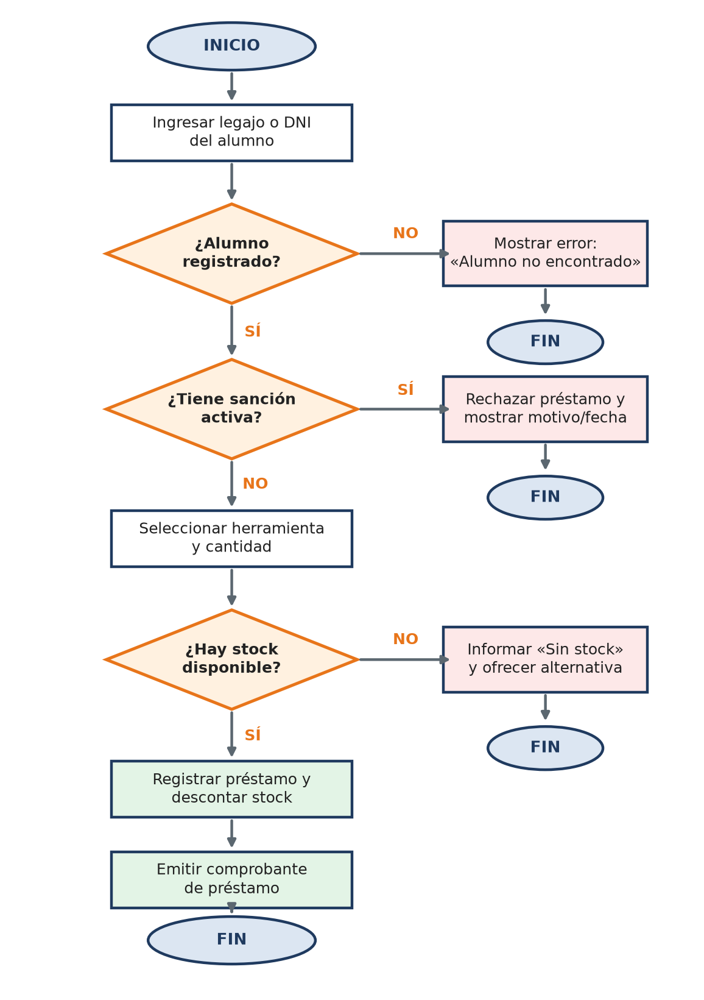
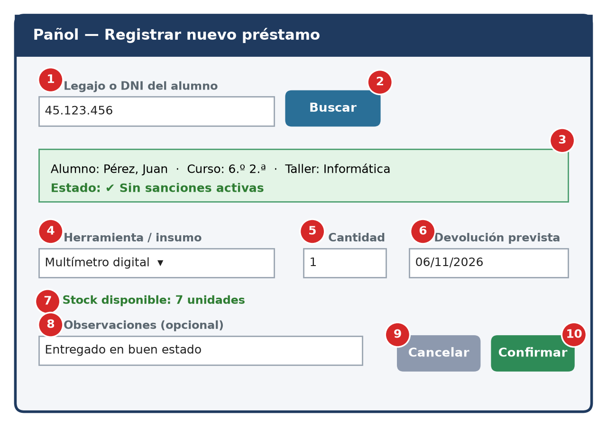

<<<<<<< HEAD
# Manual de Usuario — Sistema de Gestión de Préstamos de Pañol Escolar

Trabajo Integrador Individual · **Modelos y Sistemas** · 7.º año · Escuela Técnica

**Alumno/a:** _(completar)_
**Profesor/a:** _(completar)_
**Fecha de entrega:** _(completar)_

## Descripción

Documentación de usuario del sistema de préstamos del pañol escolar (Opción A de la consigna). El sistema permite controlar el stock de herramientas e insumos, registrar entregas y devoluciones a los alumnos, llevar el historial de estado de cada herramienta y reportar material dañado.

El trabajo toma como eje una tarea crítica: **registrar un nuevo préstamo con validación de sanción activa y de stock**.

## Contenido del repositorio

```
├── docs/
│   ├── Manual_de_Usuario_Panol.docx          # Documento completo (Word)
│   └── Presentacion_Manual_de_Usuario.pptx   # Presentación de apoyo visual
├── img/
│   ├── flujo.png                             # Diagrama de flujo del préstamo
│   └── mockup.png                            # Captura de interfaz anotada
└── README.md
```

## Apartados desarrollados

| Apartado | Contenido |
|---|---|
| 1. Marco conceptual | Documentación de usuario vs. técnica y clasificación de ejemplos |
| 2. Paso a paso | Instructivo con tarea, objetivo, prerrequisitos, pasos, resultado esperado y errores |
| 3. Diagrama de flujo | Circuito de préstamo con tres caminos de error |
| 4. Caso de uso | CU-01 con actor, precondiciones, flujo principal y alternativos |
| 5. Captura anotada | Pantalla «Registrar nuevo préstamo» con 10 referencias numéricas |

## Vista previa

### Diagrama de flujo



### Interfaz anotada



## Nota

La pantalla y los mensajes mostrados son un modelo (mockup) creado para este trabajo.
=======
# Proyecto integrador - Gian Franco
Proyecto integrador
>>>>>>> e6b22c3c2fbd7586648186a64d6f05ce4eb6d18a
